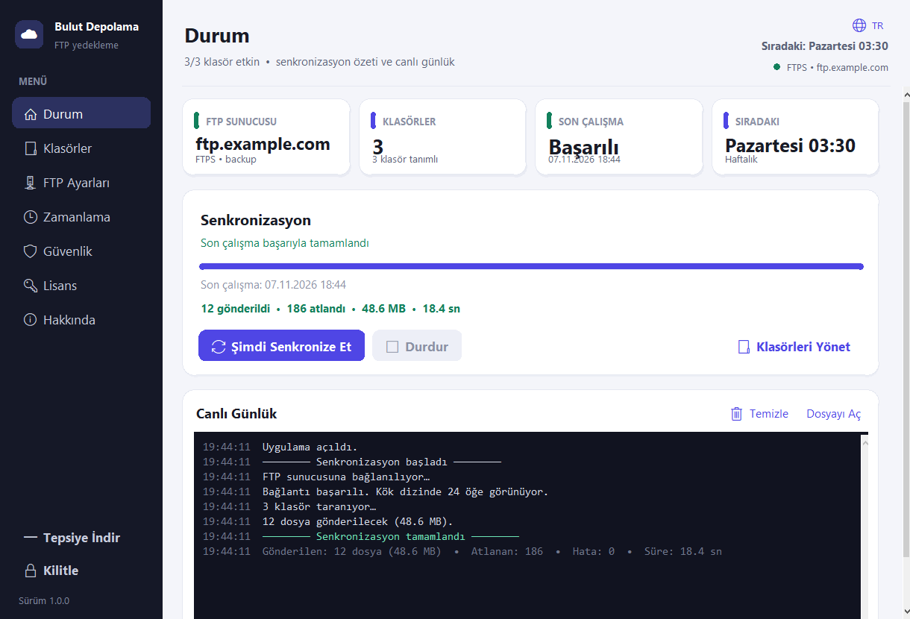
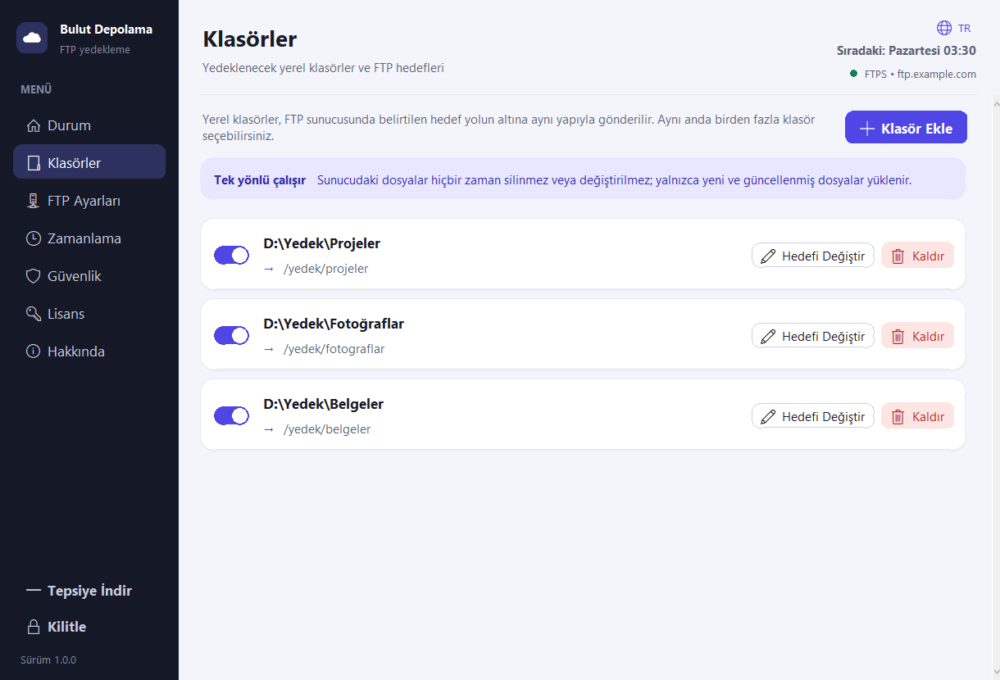
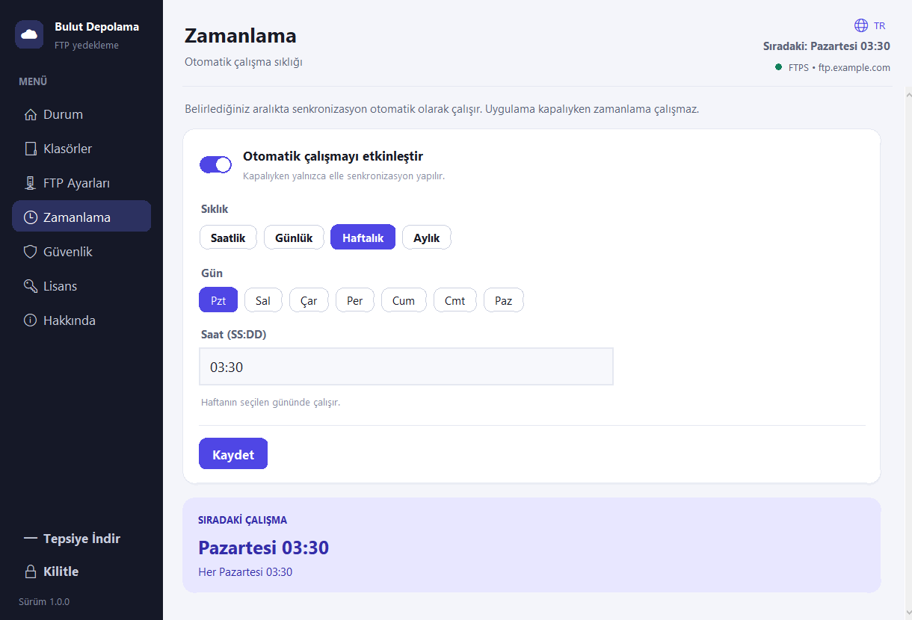
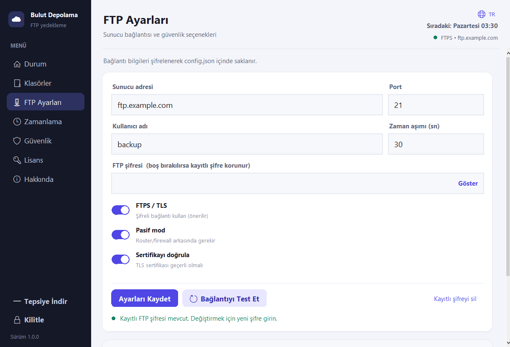
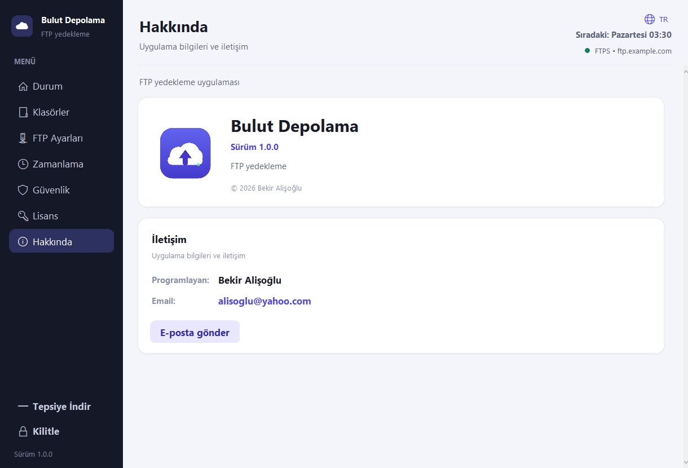
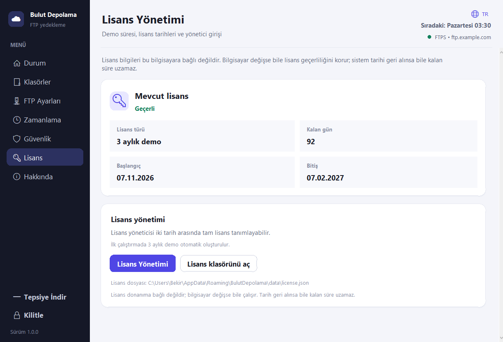

# Bulut Depolama

Modern (Material Design 3 esintili) arayüzlü, **tek yönlü** FTP yedekleme
uygulaması. Windows ve Linux üzerinde Python + Tkinter ile çalışır; çalışma
zamanında harici kütüphane gerektirmez.

[Türkçe](README.md) • [English](README.en.md) • [Deutsch](README.de.md) •
[Français](README.fr.md) • [Español](README.es.md) • [Português](README.pt.md) •
[Русский](README.ru.md) • [Українська](README.uk.md) • [Azərbaycanca](README.az.md) •
[Türkmençe](README.tk.md) • [Oʻzbekcha](README.uz.md) • [日本語](README.ja.md) •
[简体中文](README.zh.md) • [한국어](README.ko.md) • [Қазақша](README.kk.md) •
[Татарча](README.tt.md) • [Тоҷикӣ](README.tg.md)



| Klasörler | Zamanlama |
|---|---|
|  |  |
| FTP Ayarları | Hakkında |
|  |  |

## Özellikler

- **Birden fazla klasör** seçimi ve her klasör için ayrı FTP hedef yolu.
- **Tek yönlü senkronizasyon**: yalnızca yerelden sunucuya. Sunucuda **hiçbir
  zaman silme** yapılmaz, sunucudaki fazla dosyalar korunur.
- **Akıllı gönderim**: sunucudaki dosyanın boyutu ve değişim tarihi yerelle
  aynıysa atlanır; sadece yeni ve güncellenmiş dosyalar yüklenir.
- **Zamanlama**: saatlik (N saatte bir), günlük, haftalık (gün seçimli), aylık.
  Bir sonraki çalışma zamanı arayüzde gösterilir.
- **Şifre koruması**: uygulama açılışında şifre sorulur; ayarlar, FTP bilgileri ve
  klasör listesi bu şifre olmadan görülemez. Şifre değiştirilebilir, uygulama
  elle kilitlenebilir.
- **Şifreli saklama**: FTP şifresi, PBKDF2 ile türetilen anahtarla (HMAC-SHA256
  akış şifresi + MAC) şifrelenerek `config.json` içinde tutulur.
- **Dayanıklılık**: bağlantı koparsa otomatik yeniden bağlanıp devam eder; iptal
  edilen yüklemenin yarım dosyası sunucudan temizlenir.
- **FTPS/TLS** desteği, pasif/aktif mod, sertifika doğrulama seçeneği, hariç
  tutma kalıpları ve gizli dosya yönetimi.
- **17 dil**, canlı günlük, Windows sistem tepsisi ve Windows/Linux otomatik
  başlatma.
- **Hakkında** sayfası: sürüm bilgisi, geliştirici ve e-posta adresi.

## Kurulum ve çalıştırma

Python 3.10+ (test edilen: 3.13) gerekir.

```powershell
python main.py
```

veya `baslat.bat` dosyasına çift tıklayın.

İlk açılışta bir **uygulama şifresi** oluşturmanız istenir. Bu şifre kaybolursa
kurtarılamaz; `config.json` silinerek uygulama sıfırlanabilir (tüm ayarlar ve
kayıtlı FTP şifresi de silinir).

### Kullanım akışı

1. **FTP Ayarları**: sunucu adresi, port, kullanıcı ve şifreyi girin, gerekirse
   FTPS'i açın. “Bağlantıyı Test Et” ile doğrulayın, ardından kaydedin.
2. **Klasörler**: “Klasör Ekle” ile bir veya birden fazla klasör seçin. Tek
   klasör seçiminde hedef yolu sorulur; çoklu seçimde her klasör kendi adıyla
   (`/KlasorAdi`) eşlenir. Hedef yollar daha sonra düzenlenebilir.
3. **Zamanlama**: sıklığı seçip etkinleştirin ve kaydedin. Zamanlama yalnızca
   uygulama açıkken çalışır.
4. **Durum**: “Şimdi Senkronize Et” ile elle çalıştırın; ilerleme, hız, canlı
   günlük ve sonuç özetini izleyin.
5. **Hakkında**: sürüm, geliştirici ve e-posta bilgilerini görüntüleyin.

### Eşleme örneği

| Yerel | FTP hedefi |
|---|---|
| `C:\Users\Ali\Belgeler` | `/yedek/belgeler` |
| `C:\Projeler` | `/yedek/projeler` |

`C:\Projeler\src\app.py` dosyası sunucuda `/yedek/projeler/src/app.py` olarak
görünür. Boş klasörler sunucuda oluşturulmaz.

## Veri ve günlük konumları

- **Kaynak modunda**: proje yanındaki `data/config.json` ve `logs/app.log`.
- **Windows paketinde**: `%APPDATA%\BulutDepolama\data` ve
  `%APPDATA%\BulutDepolama\logs`.
- **Linux paketinde**: `$XDG_CONFIG_HOME/bulut-depolama` (genellikle
  `~/.config/bulut-depolama`) altında `data` ve `logs`.
- **Taşınabilir mod**: `BULUT_PORTABLE=1` ortam değişkeni veya uygulama yanında
  `portable.flag` dosyası.
- **Özel konum**: `BULUT_DATA_DIR` ortam değişkeni.

## Windows derleme

Gereksinim: Python 3.10+ ve PyInstaller (betik gerekirse kurar).

```powershell
powershell -ExecutionPolicy Bypass -File packaging\windows\build.ps1
```

Çıktı: `dist\BulutDepolama.exe` (tek dosya, GUI). Simge `assets/icon.ico`,
sürüm bilgisi `packaging/windows/version_info.txt` dosyasından alınır.

## Linux derleme

Ubuntu 22.04+ / Debian tabanlı sistemlerde:

```bash
sudo apt install python3 python3-venv python3-pip dpkg-dev squashfs-tools \
    libfuse2 desktop-file-utils curl
bash packaging/linux/build.sh
```

Çıktılar:

- `dist/BulutDepolama-x86_64.AppImage`
- `dist/bulut-depolama_1.0.0_amd64.deb`

AppImage'ı çalıştırmak için FUSE gerekir:

```bash
./dist/BulutDepolama-x86_64.AppImage
```

FUSE yoksa:

```bash
APPIMAGE_EXTRACT_AND_RUN=1 ./dist/BulutDepolama-x86_64.AppImage
```

`.deb` kurulumu:

```bash
sudo apt install ./dist/bulut-depolama_1.0.0_amd64.deb
bulut-depolama
```

Linux'ta sistem tepsisi desteği yoktur; pencere davranışı ve oturum açılışında
başlatma XDG autostart ile yönetilir.

## Ne zaman dosya gönderilir?

| Durum | Davranış |
|---|---|
| Dosya sunucuda yok | Gönderilir (yeni) |
| Boyut farklı | Gönderilir (güncellendi) |
| Yerel tarih sunucudan yeni (tolerans: 120 sn) | Gönderilir (güncellendi) |
| Boyut ve tarih aynı | Atlanır |
| Dosya yerelde silinmiş | Sunucudaki silinmez |
| Sunucuda fazladan dosya var | Korunur |

Tarih karşılaştırması için sunucuda `MFMT` desteği gerekir; desteklenmiyorsa
boyut karşılaştırması kullanılır ve bu durum günlüğe yazılır.

## Dil desteği

Arayüz 17 dili destekler:

Türkçe, English, Deutsch, Français, Español, Português, Русский, Українська,
Azərbaycanca, Türkmençe, Oʻzbekcha, 日本語, 简体中文, 한국어, Қазақша, Татарча,
Тоҷикӣ.

Dil; giriş ekranından, başlıktan ve Güvenlik sayfasından değiştirilebilir.
Çeviriler `app/locales/<kod>.json` dosyalarındadır. Eksik bir anahtar varsa
İngilizceye, o da yoksa anahtar adına düşülür.

## Test

```powershell
python -m app.crypto
python main.py --version
python main.py --smoke-test
```

`--smoke-test` paketlenmiş varlıkları ve 17 dil dosyasının tamamını doğrular.
Proje; yerel FTP sunucusu (`pyftpdlib`) ile E2E senkronizasyon, iptal ve
zamanlayıcı davranışı açısından test edilmiştir.

## Dosya yapısı

```
main.py                 Giriş noktası (pencere, kilit, olay döngüsü)
app/
  theme.py              Renkler ve tipografi
  widgets.py            Material bileşenler
  icons.py              Platforma uygun ikon kodları
  i18n.py               Dil yükleme, tr(), tarih/hafta günü biçimlendirme
  locales/              17 dil JSON dosyası
  crypto.py             PBKDF2 anahtar türetme, şifreleme/doğrulama
  config.py             Ayar dosyası yönetimi (atomik JSON)
  sync.py               FTP istemcisi ve tek yönlü senkronizasyon motoru
  scheduler.py          Saatlik/günlük/haftalık/aylık zamanlama
  context.py            Oturum, arka plan işleri, olay kuyruğu, günlük
  folder_picker.py      Windows çoklu klasör seçici (COM)
  tray.py               Windows sistem tepsisi (Linux'ta devre dışı)
  startup.py            Windows registry / Linux XDG autostart
  system.py             Kaynak yolu ve dosya açma yardımcıları
  ui/                   Giriş, kabuk, dil menüsü, sayfalar
assets/                 icon.png, icon.ico, logo.png
packaging/windows/      PyInstaller derleme betiği ve sürüm bilgisi
packaging/linux/        AppImage / .deb derleme betiği, AppRun, .desktop
docs/screenshots/       Yerelleştirilmiş README ekran görüntüleri
```

## Güvenlik notları

- Uygulama şifresi diske yazılmaz; yalnızca PBKDF2 (260.000 iterasyon,
  SHA-256) türevinin doğrulayıcısı saklanır.
- FTP şifresi AES değil, standart kütüphaneyle HMAC-SHA256 tabanlı bir akış
  şifresiyle (Encrypt-then-MAC) saklanır. Yerel dosya erişimi olan bir saldırgana
  karşı ek koruma sağlar; FTP sunucusunun kendisi şifresizse trafik açıktır —
  bunun için **FTPS** kullanın.
- Girişte 5 hatalı denemeden sonra 15 saniye bekleme uygulanır.

## Geliştirici

**Programlayan:** Bekir Alişoğlu  
**E-posta:** [alisoglu@yahoo.com](mailto:alisoglu@yahoo.com)

## Lisans

İlk çalıştırmada **3 aylık demo lisans** otomatik oluşturulur. Demo süresi
boyunca tüm modüller çalışır. Süre bitince lisans uyarısı gösterilir ve
yönetici şifresiyle Lisans Yönetimi panelinden iki tarih arasında tam lisans
tanımlanabilir.

- Lisans dosyası: `data/license.json`.
- Lisans donanıma bağlı değildir; dosya başka bilgisayara kopyalanabilir.
- Sistem saati geri alınsa bile süre uzamaz; büyük saat değişikliklerinde lisans
  son güvenilir tarihe göre değerlendirilir.

