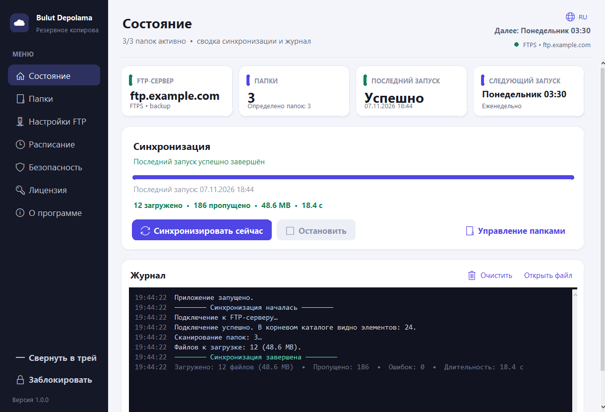
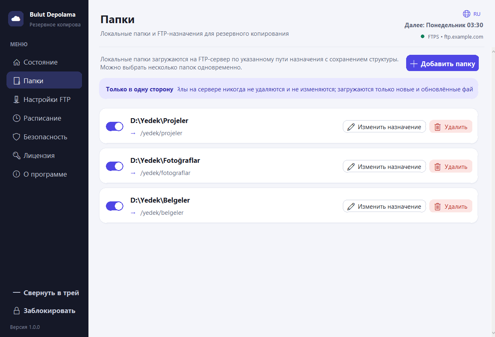
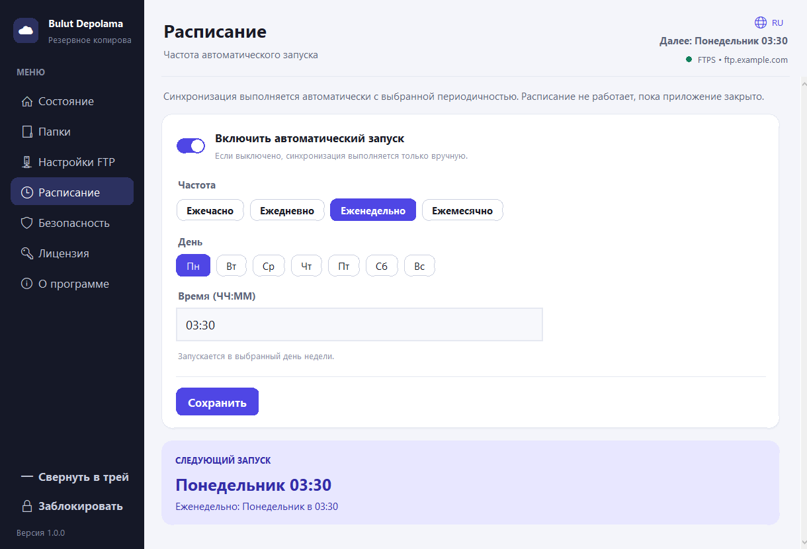
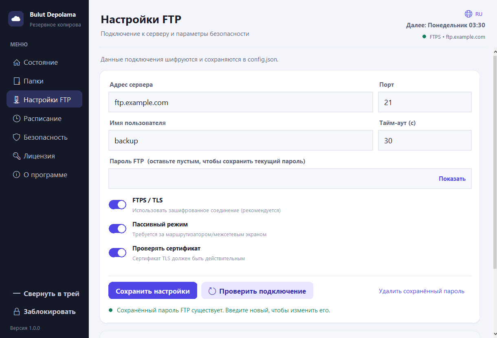
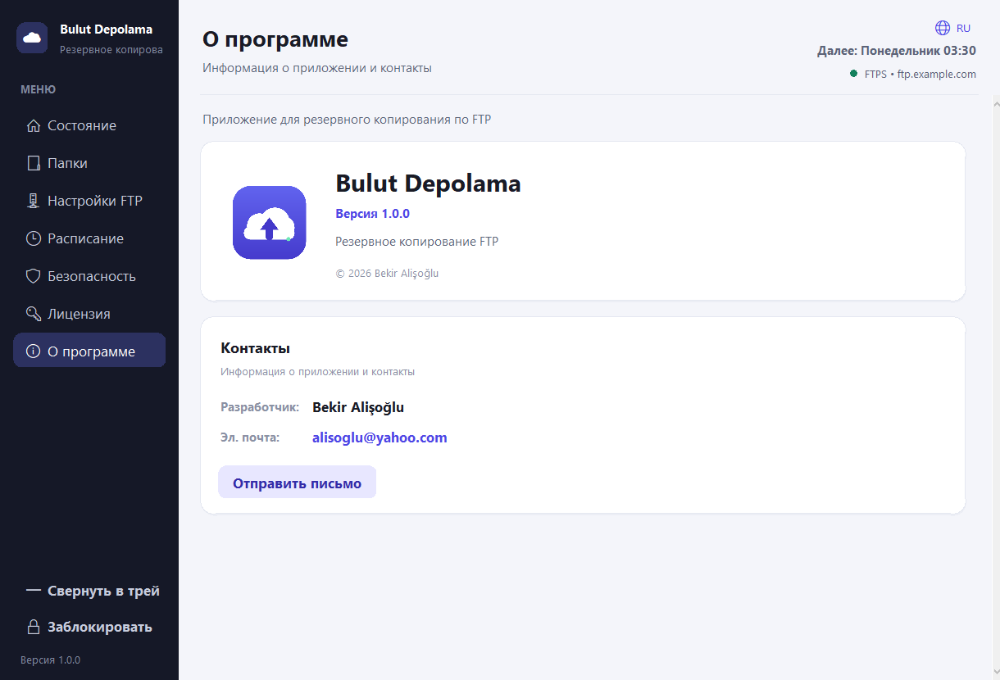
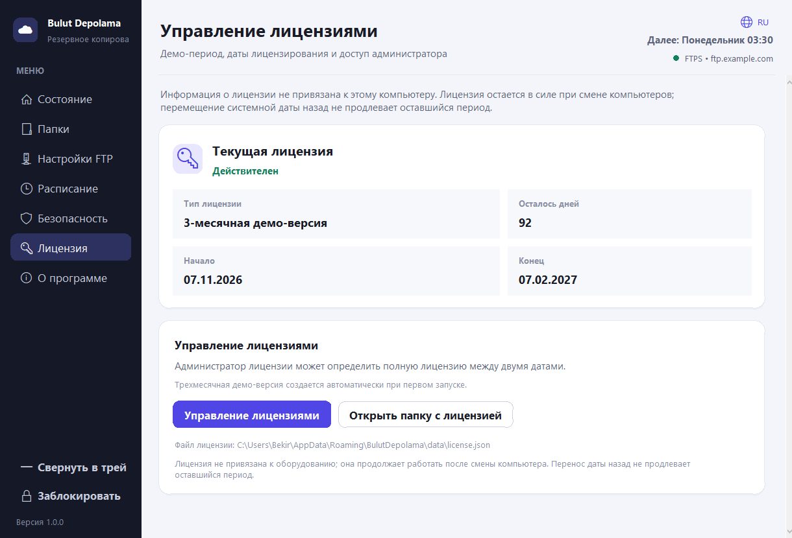

# Bulut Depolama

Современное приложение Material Design 3 для **одностороннего резервного копирования по FTP** для Windows и Linux. Построен на Python + Tkinter; никаких внешних зависимостей времени выполнения.

[Türkçe](README.md) • [English](README.en.md) • [Deutsch](README.de.md) • [Français](README.fr.md) • [Azərbaycanca](README.az.md) • [Türkmençe](README.tk.md) • [Oʻzbekcha](README.uz.md) • [Português](README.pt.md) • [Español](README.es.md)  
[Русский](README.ru.md) • [Українська](README.uk.md) • [日本語](README.ja.md) • [简体中文](README.zh.md) • [한국어](README.ko.md) • [Қазақша](README.kk.md) • [Татарча](README.tt.md) • [Тоҷикӣ](README.tg.md)



| Папки | Расписание |
|---|---|
|  |  |
| Настройки FTP | О нас |
|  |  |

## Особенности

- **Несколько папок** с отдельным путем назначения FTP для каждой папки.
- **Односторонняя синхронизация** с локального сервера на сервер. На сервере ничего не удаляется; дополнительные файлы сервера сохраняются.
- **Умная загрузка**: файлы пропускаются, если размер и время модификации совпадают; загружаются только новые и измененные файлы.
- **Расписание**: ежечасно (каждые N часов), ежедневно, еженедельно (выбор дня недели), ежемесячно. Следующее время выполнения отображается в пользовательском интерфейсе.
- **Защита паролем**: приложение запрашивает пароль при запуске. Без него настройки, данные FTP и список папок скрыты. Пароль можно изменить, а приложение заблокировать вручную.
- **Зашифрованное хранилище**: пароль FTP шифруется с помощью ключа, полученного из пароля приложения с использованием PBKDF2 (потоковый шифр HMAC-SHA256 + MAC), и сохраняется в `config.json`.
- **Устойчивость**: автоматическое переподключение и возобновление работы; частичные загрузки удаляются с сервера при отмене.
- **FTPS/TLS**, пассивный/активный режим, проверка сертификата, шаблоны исключения и обработка скрытых файлов.
- **17 языков**, оперативный журнал, системный трей Windows и автозапуск Windows/Linux.
- **О странице** с указанием версии, разработчика и адреса электронной почты.

## Быстрый старт

Требуется Python 3.10+ (проверено с версией 3.13).

```bash
python main.py
```

При первом запуске вы создаете **пароль приложения**. Его невозможно восстановить; удалите `config.json`, чтобы перезагрузить приложение (все настройки и сохраненный пароль FTP будут удалены).

Типичный рабочий процесс:

1. **Настройки FTP** — введите хост, порт, пользователя и пароль; при необходимости включите FTPS; протестируйте и сохраните.
2. **Папки** — добавьте одну или несколько локальных папок. При одном выборе запрашивается путь назначения; множественный выбор автоматически сопоставляется с `/FolderName`. Направления можно изменить позже.
3. **Расписание** — выберите частоту, включите ее и сохраните. Планирование работает только тогда, когда приложение открыто.
4. **Статус** — нажмите «Синхронизировать сейчас», чтобы запустить вручную и отслеживать прогресс, скорость, оперативный журнал и сводку результатов.
5. **О программе** — версия, разработчик и контактные данные.

### Пример сопоставления

| Местный | FTP-адресат |
|---|---|
| `C:\Users\Ali\Documents` | `/backup/documents` |
| `C:\Projects` | `/backup/projects` |

`C:\Projects\src\app.py` сохраняется как `/backup/projects/src/app.py`. Пустые папки на сервере не создаются.

## Расположение данных и журналов

- **Исходный режим**: `data/config.json` и `logs/app.log` рядом с проектом.
- **Пакет Windows**: `%APPDATA%\BulutDepolama\data` и `%APPDATA%\BulutDepolama\logs`.
- **Пакет Linux**: `$XDG_CONFIG_HOME/bulut-depolama` (обычно `~/.config/bulut-depolama`) с `data` и `logs`.
- **Переносной режим**: переменная среды `BULUT_PORTABLE=1` или файл `portable.flag` рядом с исполняемым файлом.
- **Произвольное расположение**: переменная среды `BULUT_DATA_DIR`.

## Сборка

### Windows

Требуется Python 3.10+ и PyInstaller (при необходимости скрипт установит его).

```powershell
powershell -ExecutionPolicy Bypass -File packaging\windows\build.ps1
```

Вывод: `dist\BulutDepolama.exe` (однофайловый графический интерфейс). Значок взят из `assets/icon.ico`; Метаданные версии из `packaging/windows/version_info.txt`.

### Linux

В системах на базе Ubuntu 22.04+/Debian:

```bash
sudo apt install python3 python3-venv python3-pip dpkg-dev squashfs-tools \
    libfuse2 desktop-file-utils curl
bash packaging/linux/build.sh
```

Выходы:

- `dist/BulutDepolama-x86_64.AppImage`
- `dist/bulut-depolama_1.0.0_amd64.deb`

Запустите AppImage (требуется FUSE):

```bash
./dist/BulutDepolama-x86_64.AppImage
```

Без ПРЕДОХРАНИТЕЛЯ:

```bash
APPIMAGE_EXTRACT_AND_RUN=1 ./dist/BulutDepolama-x86_64.AppImage
```

Установите `.deb`:

```bash
sudo apt install ./dist/bulut-depolama_1.0.0_amd64.deb
bulut-depolama
```

Linux не поддерживает системный трей; поведение окна и автозапуск управляются через автозапуск XDG.

## Когда загружается файл?

| Ситуация | Поведение |
|---|---|
| На сервере отсутствует файл | Загружено (новое) |
| Размер отличается | Загружено (обновлено) |
| Время локальной модификации более новое (допуск: 120 с) | Загружено (обновлено) |
| Соответствие размера и времени | Пропущено |
| Файл был удален локально | Хранится на сервере |
| Дополнительный файл на сервере | Сохранено |

Для сравнения дат требуется поддержка `MFMT` на сервере; если недоступно, используется сравнение размеров, и это записывается в журнал.

## Языки

Интерфейс поддерживает 17 языков:

- Türkçe
- English
- Deutsch
- Français
- Azərbaycanca
- Türkmençe
- Oʻzbekcha
- Português
- Español
- Русский
- Українська
- 日本語
- 简体中文
- 한국어
- Қазақша
- Татарча
- Тоҷикӣ

Измените язык на экране входа в систему, в заголовке или на странице безопасности. Переводы доступны в `app/locales/<code>.json`; недостающие клавиши возвращаются к английскому языку.

## Тест

```bash
python -m app.crypto
python main.py --version
python main.py --smoke-test
```

`--smoke-test` проверяет упакованные ресурсы и все 17 файлов локали. Проект был протестирован с локальным FTP-сервером (`pyftpdlib`) на предмет синхронизации E2E, отмены и поведения планировщика.

## Структура проекта

```
main.py                 Entry point (window, lock, event loop)
app/
  theme.py              Colors and typography
  widgets.py            Material components
  icons.py              Platform icons
  i18n.py               Language loading, tr(), date/weekday formatting
  locales/              17 language JSON files
  crypto.py             PBKDF2 key derivation, encryption/verification
  config.py             Settings file (atomic JSON)
  sync.py               FTP client and one-way sync engine
  scheduler.py          Hourly/daily/weekly/monthly scheduling
  context.py            Session, background jobs, event queue, logging
  folder_picker.py      Windows multi-folder picker (COM)
  tray.py               Windows system tray (disabled on Linux)
  startup.py            Windows registry / Linux XDG autostart
  system.py             Resource path and file-open helpers
  ui/                   Login, shell, language menu, pages
assets/                 icon.png, icon.ico, logo.png
packaging/windows/      PyInstaller build script and version info
packaging/linux/        AppImage / .deb build script, AppRun, .desktop
docs/screenshots/       Localized README screenshots
```

## Примечания по безопасности

- Пароль приложения никогда не записывается на диск; сохраняется только верификатор PBKDF2 (260 000 итераций, SHA-256).
- Пароль FTP шифруется с помощью потокового шифра стандартной библиотеки HMAC-SHA256 (зашифровать-затем-MAC), а не AES. Он защищает от доступа к локальным файлам; Сам FTP-трафик не зашифрован, если вы не включите **FTPS**.
- Пять неудачных попыток входа вызывают 15-секундную задержку.

## Разработчик

**Разработчик:** Бекир Алишоглу  
**Электронная почта:** [alisoglu@yahoo.com](mailto:alisoglu@yahoo.com)

## Лицензия

**3-месячная демо-лицензия** создается автоматически при первом запуске. Все модули работают во время демо. По истечении срока действия отображается предупреждение о лицензии, и полную лицензию можно определить между двумя датами на панели управления лицензиями с помощью пароля администратора.

- Файл лицензии: `data/license.json`.
- Лицензия не привязана к оборудованию; файл можно скопировать на другой компьютер.
- Перемещение системных часов назад не продлевает лицензию; после больших изменений времени лицензия оценивается с использованием последней доверенной даты.

