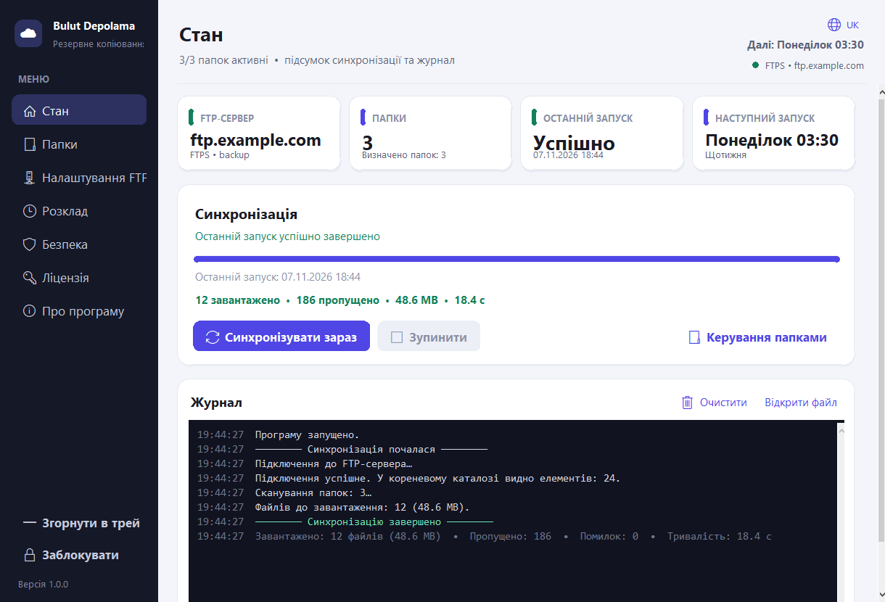
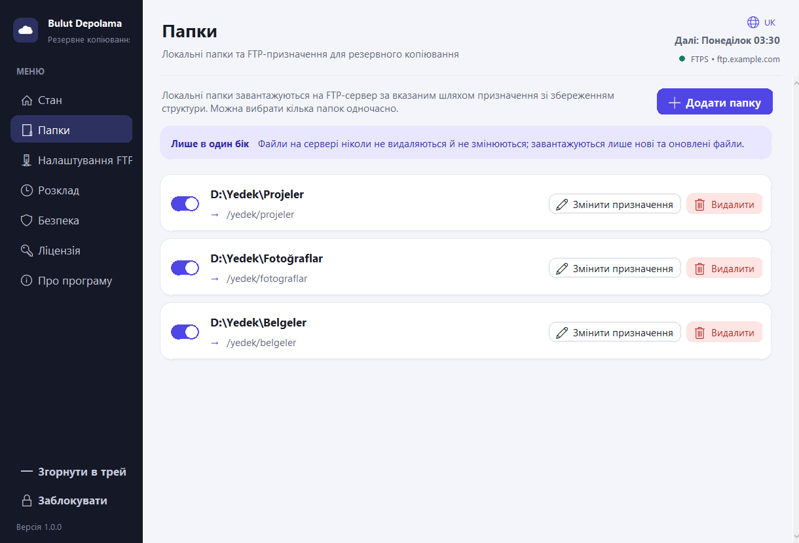
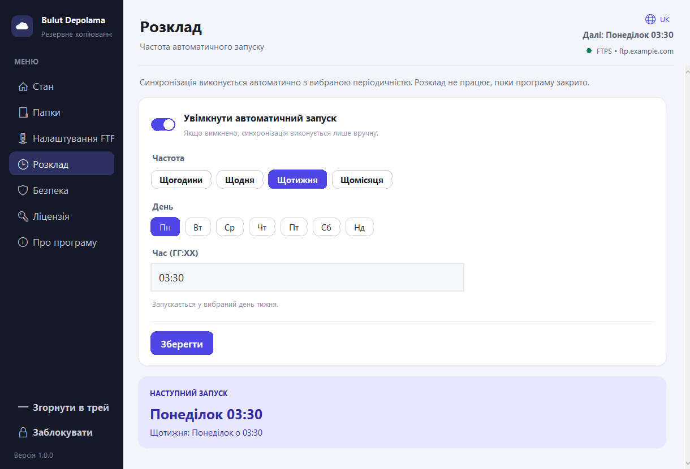
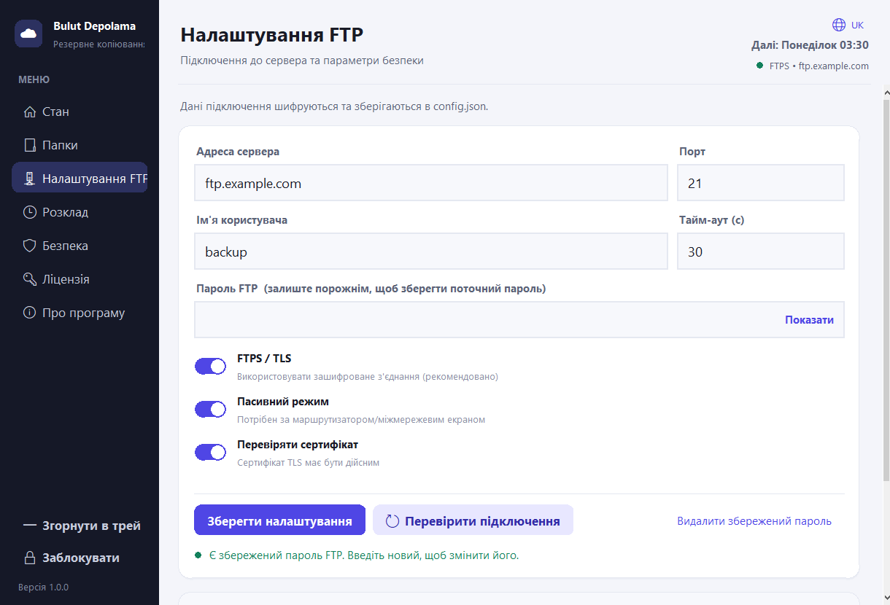
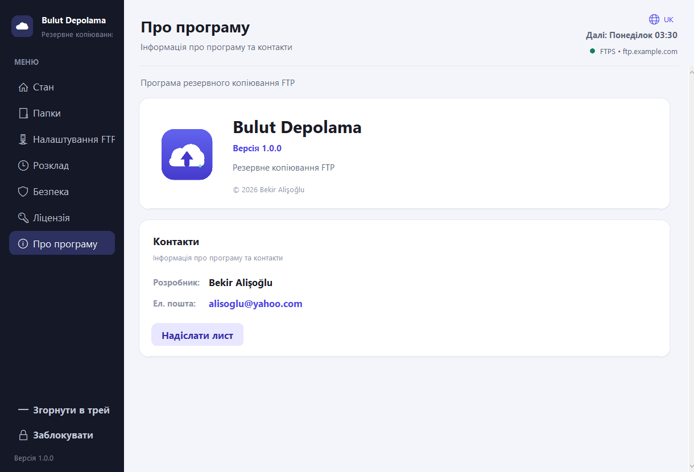
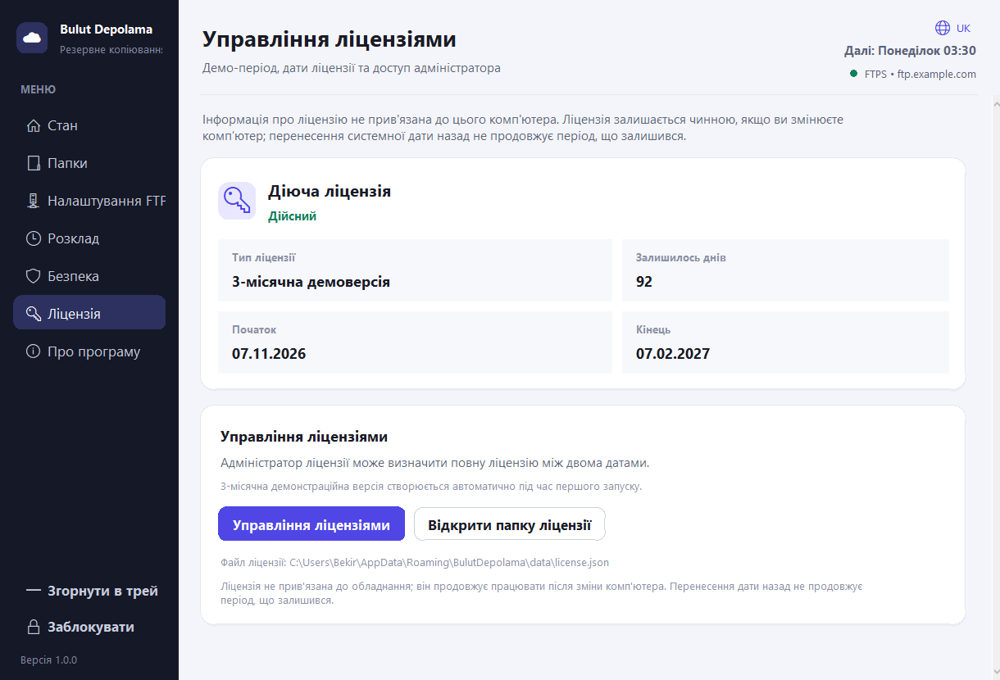

# Bulut Depolama

Сучасний додаток для **одностороннього резервного копіювання FTP** для Windows і Linux, натхненний Material Design 3. Створено за допомогою Python + Tkinter; немає зовнішніх залежностей середовища виконання.

[Türkçe](README.md) • [English](README.en.md) • [Deutsch](README.de.md) • [Français](README.fr.md) • [Azərbaycanca](README.az.md) • [Türkmençe](README.tk.md) • [Oʻzbekcha](README.uz.md) • [Português](README.pt.md) • [Español](README.es.md)  
[Русский](README.ru.md) • [Українська](README.uk.md) • [日本語](README.ja.md) • [简体中文](README.zh.md) • [한국어](README.ko.md) • [Қазақша](README.kk.md) • [Татарча](README.tt.md) • [Тоҷикӣ](README.tg.md)



| Папки | Розклад |
|---|---|
|  |  |
| Налаштування FTP | Про |
|  |  |

## Особливості

- **Кілька папок** з окремим шляхом призначення FTP для кожної папки.
- **Одностороння синхронізація** з локального на сервер. На сервері нічого не видаляється; додаткові серверні файли зберігаються.
- **Розумне завантаження**: файли пропускаються, якщо розмір і час модифікації збігаються; завантажуються лише нові та змінені файли.
- **Планування**: щогодини (кожні N годин), щодня, щотижня (вибір дня тижня), щомісяця. Час наступного запуску відображається в інтерфейсі користувача.
- **Захист паролем**: додаток запитує пароль під час запуску. Налаштування, деталі FTP і список папок приховані без нього. Пароль можна змінити, а програму можна заблокувати вручну.
- **Зашифроване сховище**: пароль FTP шифрується за допомогою ключа, отриманого з пароля програми за допомогою PBKDF2 (шифр потоку HMAC-SHA256 + MAC) і зберігається в `config.json`.
- **Стійкість**: автоматичне повторне підключення та відновлення; часткові завантаження видаляються з сервера після скасування.
- **FTPS/TLS**, пасивний/активний режим, перевірка сертифіката, шаблони виключення та обробка прихованих файлів.
- **17 мов**, оперативний журнал, системний трей Windows і автозапуск Windows/Linux.
- **Сторінка про програму** з версією, розробником та електронною поштою.

## Швидкий старт

Потрібен Python 3.10+ (перевірено з 3.13).

```bash
python main.py
```

Під час першого запуску ви створюєте **пароль програми**. Його неможливо відновити; видаліть `config.json`, щоб скинути програму (усі налаштування та збережений пароль FTP буде видалено).

Типовий робочий процес:

1. **Налаштування FTP** — введіть хост, порт, користувача та пароль; увімкніть FTPS, якщо потрібно; перевірте та збережіть.
2. **Папки** — додайте одну або кілька локальних папок. Один вибір запитує шлях призначення; кілька виділень автоматично відображаються на `/FolderName`. Пункти призначення можна змінити пізніше.
3. **Розклад** — виберіть частоту, увімкніть і збережіть. Планування працює, лише коли програма відкрита.
4. **Статус** — натисніть «Синхронізувати зараз», щоб запустити вручну та стежити за прогресом, швидкістю, поточним журналом і підсумковим підсумком.
5. **Про** — версія, розробник і контактні дані.

### Приклад відображення

| Місцевий | Призначення FTP |
|---|---|
| `C:\Users\Ali\Documents` | `/backup/documents` |
| `C:\Projects` | `/backup/projects` |

`C:\Projects\src\app.py` зберігається як `/backup/projects/src/app.py`. Порожні папки на сервері не створюються.

## Розташування даних і журналів

- **Режим джерела**: `data/config.json` і `logs/app.log` поруч із проектом.
- **пакет Windows**: `%APPDATA%\BulutDepolama\data` і `%APPDATA%\BulutDepolama\logs`.
- **Пакет Linux**: `$XDG_CONFIG_HOME/bulut-depolama` (зазвичай `~/.config/bulut-depolama`) з `data` і `logs`.
- **Портативний режим**: змінна середовища `BULUT_PORTABLE=1` або файл `portable.flag` поруч із виконуваним файлом.
- **Користувацьке розташування**: змінна середовища `BULUT_DATA_DIR`.

## Будувати

### Windows

Потрібен Python 3.10+ і PyInstaller (сценарій встановлює його за потреби).

```powershell
powershell -ExecutionPolicy Bypass -File packaging\windows\build.ps1
```

Вихід: `dist\BulutDepolama.exe` (однофайловий GUI). Піктограма походить від `assets/icon.ico`; метадані версії з `packaging/windows/version_info.txt`.

### Linux

У системах Ubuntu 22.04+/Debian:

```bash
sudo apt install python3 python3-venv python3-pip dpkg-dev squashfs-tools \
    libfuse2 desktop-file-utils curl
bash packaging/linux/build.sh
```

Виходи:

- `dist/BulutDepolama-x86_64.AppImage`
- `dist/bulut-depolama_1.0.0_amd64.deb`

Запустіть AppImage (потрібен FUSE):

```bash
./dist/BulutDepolama-x86_64.AppImage
```

Без запобіжника:

```bash
APPIMAGE_EXTRACT_AND_RUN=1 ./dist/BulutDepolama-x86_64.AppImage
```

Встановіть `.deb`:

```bash
sudo apt install ./dist/bulut-depolama_1.0.0_amd64.deb
bulut-depolama
```

Linux не підтримує системний трей; поведінкою вікна та автозапуском керуються через автозапуск XDG.

## Коли завантажується файл?

| Ситуація | Поведінка |
|---|---|
| Файл відсутній на сервері | Завантажено (нове) |
| Розмір відрізняється | Завантажено (оновлено) |
| Локальний час модифікації новіший (допуск: 120 с) | Завантажено (оновлено) |
| Розмір і час відповідають | Пропущено |
| Файл було видалено локально | Зберігається на сервері |
| Додатковий файл на сервері | Збереглися |

Порівняння дат потребує підтримки `MFMT` на сервері; якщо недоступний, використовується порівняння розмірів, і це записується в журнал.

## Мови

Інтерфейс підтримує 17 мов:

- Türkçe
- English
- Deutsch
- Français
- Azərbaycanca
- Türkmençe
- Oʻzbekcha
- Português
- Español
- Русский
- Українська
- 日本語
- 简体中文
- 한국어
- Қазақша
- Татарча
- Тоҷикӣ

Змініть мову на екрані входу, у заголовку або на сторінці безпеки. Переклади живі в `app/locales/<code>.json`; відсутні ключі повертаються до англійської мови.

## Тест

```bash
python -m app.crypto
python main.py --version
python main.py --smoke-test
```

`--smoke-test` перевіряє запаковані активи та всі 17 файлів локалі. Проект було перевірено на локальному FTP-сервері (`pyftpdlib`) для синхронізації E2E, скасування та поведінки планувальника.

## Структура проекту

```
main.py                 Entry point (window, lock, event loop)
app/
  theme.py              Colors and typography
  widgets.py            Material components
  icons.py              Platform icons
  i18n.py               Language loading, tr(), date/weekday formatting
  locales/              17 language JSON files
  crypto.py             PBKDF2 key derivation, encryption/verification
  config.py             Settings file (atomic JSON)
  sync.py               FTP client and one-way sync engine
  scheduler.py          Hourly/daily/weekly/monthly scheduling
  context.py            Session, background jobs, event queue, logging
  folder_picker.py      Windows multi-folder picker (COM)
  tray.py               Windows system tray (disabled on Linux)
  startup.py            Windows registry / Linux XDG autostart
  system.py             Resource path and file-open helpers
  ui/                   Login, shell, language menu, pages
assets/                 icon.png, icon.ico, logo.png
packaging/windows/      PyInstaller build script and version info
packaging/linux/        AppImage / .deb build script, AppRun, .desktop
docs/screenshots/       Localized README screenshots
```

## Примітки щодо безпеки

- Пароль програми ніколи не записується на диск; зберігається тільки верифікатор PBKDF2 (260 000 ітерацій, SHA-256).
- Пароль FTP зашифровано потоковим шифром стандартної бібліотеки HMAC-SHA256 (encrypt-then-MAC), а не AES. Він захищає від доступу до локальних файлів; Сам FTP-трафік незашифрований, якщо ви не ввімкнете **FTPS**.
- П'ять невдалих спроб входу викликають 15-секундну затримку.

## Розробник

**Розробник:** Бекір Алішоглу  
**Електронна адреса:** [alisoglu@yahoo.com](mailto:alisoglu@yahoo.com)

## Ліцензія

**3-місячна демонстраційна ліцензія** створюється автоматично під час першого запуску. Усі модулі працюють під час демонстрації. Після закінчення терміну дії з’являється попередження про ліцензію, і повну ліцензію можна визначити між двома датами на панелі керування ліцензіями за допомогою пароля адміністратора.

- Файл ліцензії: `data/license.json`.
- Ліцензія не прив'язана до обладнання; файл можна скопіювати на інший комп'ютер.
- Переведення системного годинника назад не продовжує ліцензію; після великих змін годинника ліцензія оцінюється з використанням останньої надійної дати.

