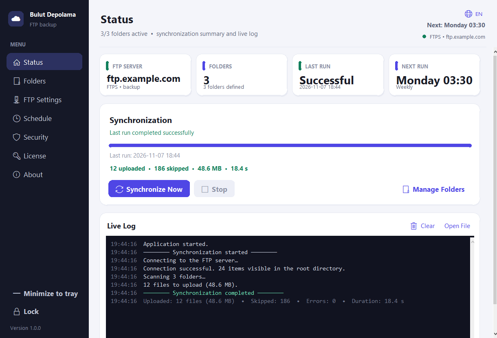
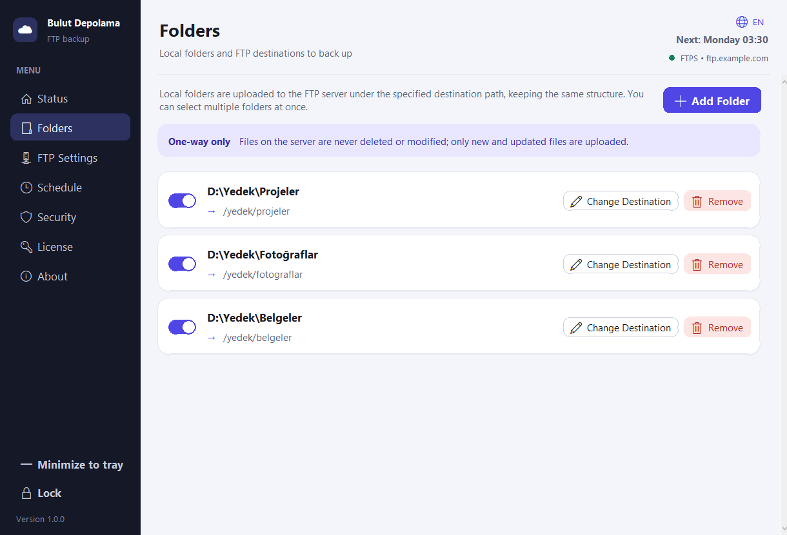
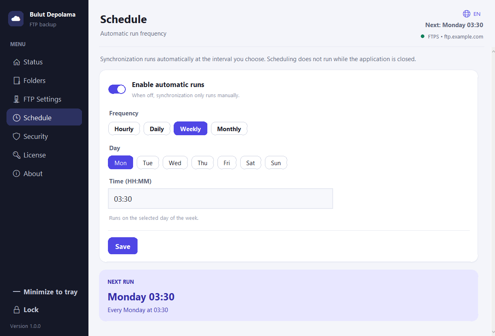
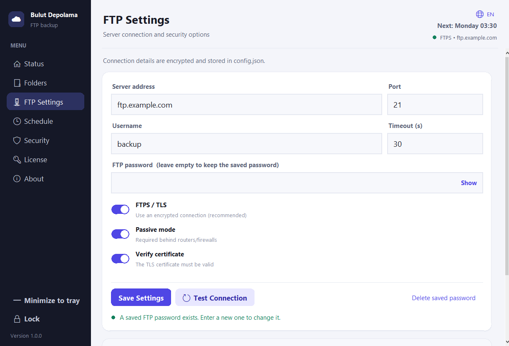
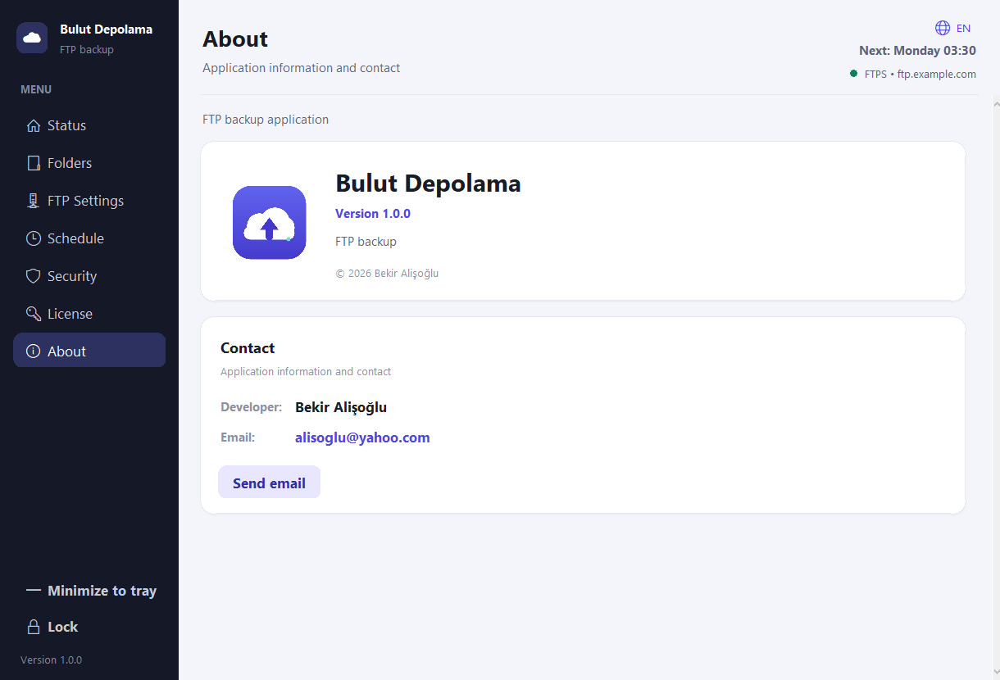
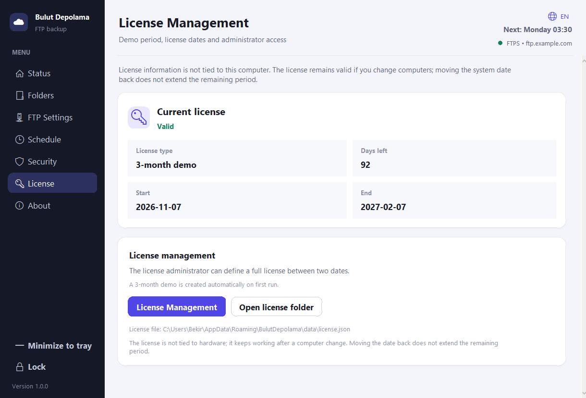

# Bulut Depolama

现代、Material Design 3 启发的**单向 FTP 备份**应用程序，适用于 Windows 和 Linux。使用 Python + Tkinter 构建；没有外部运行时依赖。

[Türkçe](README.md) • [English](README.en.md) • [Deutsch](README.de.md) • [Français](README.fr.md) • [Azərbaycanca](README.az.md) • [Türkmençe](README.tk.md) • [Oʻzbekcha](README.uz.md) • [Português](README.pt.md) • [Español](README.es.md)  
[Русский](README.ru.md) • [Українська](README.uk.md) • [日本語](README.ja.md) • [简体中文](README.zh.md) • [한국어](README.ko.md) • [Қазақша](README.kk.md) • [Татарча](README.tt.md) • [Тоҷикӣ](README.tg.md)



|文件夹|日程 |
|---|---|
|  |  |
| FTP 设置 |关于 |
|  |  |

## 特点

- **多个文件夹**，每个文件夹都有单独的 FTP 目标路径。
- **从本地到服务器的单向同步**。服务器上的任何内容都不会被删除；保留额外的服务器文件。
- **智能上传**：当大小和修改时间匹配时跳过文件；仅上传新文件和更改的文件。
- **计划**：每小时（每 N 小时）、每天、每周（工作日选择）、每月。下一次运行时间显示在 UI 中。
- **密码保护**：应用程序在启动时要求输入密码。如果没有它，设置、FTP 详细信息和文件夹列表将被隐藏。可以更改密码并可以手动锁定应用程序。
- **加密存储**：FTP 密码使用 PBKDF2（HMAC-SHA256 流密码 + MAC）使用从应用程序密码派生的密钥进行加密，并存储在 `config.json` 中。
- **弹性**：自动重新连接和恢复；取消时，部分上传将从服务器中清除。
- **FTPS/TLS**、被动/主动模式、证书验证、排除模式和隐藏文件处理。
- **17 种语言**、实时日志、Windows 系统托盘和 Windows/Linux 自动启动。
- **关于页面**，包含版本、开发人员和电子邮件。

## 快速开始

需要 Python 3.10+（使用 3.13 测试）。

```bash
python main.py
```

首次启动时，您创建一个**应用程序密码**。无法恢复；删除 `config.json` 以重置应用程序（所有设置和保存的 FTP 密码都将被删除）。

典型工作流程：

1. **FTP设置**——输入主机、端口、用户和密码；如果需要，启用 FTPS；测试并保存。
2. **文件夹** — 添加一个或多个本地文件夹。单个选择要求提供目标路径；多个选择会自动映射到 `/FolderName`。稍后可以编辑目的地。
3. **时间表** — 选择频率，启用并保存。计划仅在应用程序打开时运行。
4. **状态** — 单击“立即同步”手动运行并跟踪进度、速度、实时日志和结果摘要。
5. **关于** — 版本、开发者和联系方式。

### 映射示例

|本地| FTP 目的地 |
|---|---|
| `C:\Users\Ali\Documents` | `/backup/documents` |
| `C:\Projects` | `/backup/projects` |

`C:\Projects\src\app.py` 存储为 `/backup/projects/src/app.py`。服务器上不会创建空文件夹。

## 数据和日志位置

- **源模式**：项目旁边的 `data/config.json` 和 `logs/app.log`。
- **Windows 软件包**：`%APPDATA%\BulutDepolama\data` 和 `%APPDATA%\BulutDepolama\logs`。
- **Linux 软件包**：`$XDG_CONFIG_HOME/bulut-depolama`（通常是 `~/.config/bulut-depolama`）以及 `data` 和 `logs`。
- **便携式模式**：`BULUT_PORTABLE=1` 环境变量或可执行文件旁边的 `portable.flag` 文件。
- **自定义位置**：`BULUT_DATA_DIR` 环境变量。

## 构建

### Windows

需要 Python 3.10+ 和 PyInstaller（如果需要，脚本会安装它）。

```powershell
powershell -ExecutionPolicy Bypass -File packaging\windows\build.ps1
```

输出：`dist\BulutDepolama.exe`（单文件 GUI）。图标来自`assets/icon.ico`；来自 `packaging/windows/version_info.txt` 的版本元数据。

### Linux

在 Ubuntu 22.04+ / 基于 Debian 的系统上：

```bash
sudo apt install python3 python3-venv python3-pip dpkg-dev squashfs-tools \
    libfuse2 desktop-file-utils curl
bash packaging/linux/build.sh
```

输出：

- `dist/BulutDepolama-x86_64.AppImage`
- `dist/bulut-depolama_1.0.0_amd64.deb`

运行AppImage（需要FUSE）：

```bash
./dist/BulutDepolama-x86_64.AppImage
```

不带保险丝：

```bash
APPIMAGE_EXTRACT_AND_RUN=1 ./dist/BulutDepolama-x86_64.AppImage
```

安装`.deb`：

```bash
sudo apt install ./dist/bulut-depolama_1.0.0_amd64.deb
bulut-depolama
```

Linux 没有系统托盘支持；窗口行为和自动启动通过 XDG 自动启动进行管理。

## 文件何时上传？

|情况|行为 |
|---|---|
|服务器上缺少文件 |已上传（新）|
|尺寸不同 |已上传（已更新）|
|本地修改时间较新（容差：120 s）|已上传（已更新）|
|尺寸与时间匹配 |已跳过 |
|文件已在本地删除 |保存在服务器上 |
|服务器上的额外文件 |保存|

日期比较需要服务器上有`MFMT`支持；如果不可用，则使用大小比较并将其写入日志。

## 语言

界面支持17种语言：

- Türkçe
- English
- Deutsch
- Français
- Azərbaycanca
- Türkmençe
- Oʻzbekcha
- Português
- Español
- Русский
- Українська
- 日本語
- 简体中文
- 한국어
- Қазақша
- Татарча
- Тоҷикӣ

从登录屏幕、标题或安全页面更改语言。翻译在 `app/locales/<code>.json` 中进行；丢失的键会恢复为英语。

## 测试

```bash
python -m app.crypto
python main.py --version
python main.py --smoke-test
```

`--smoke-test` 验证打包的资源和所有 17 个语言环境文件。该项目已使用本地 FTP 服务器 (`pyftpdlib`) 进行了 E2E 同步、取消和调度程序行为的测试。

## 项目结构

```
main.py                 Entry point (window, lock, event loop)
app/
  theme.py              Colors and typography
  widgets.py            Material components
  icons.py              Platform icons
  i18n.py               Language loading, tr(), date/weekday formatting
  locales/              17 language JSON files
  crypto.py             PBKDF2 key derivation, encryption/verification
  config.py             Settings file (atomic JSON)
  sync.py               FTP client and one-way sync engine
  scheduler.py          Hourly/daily/weekly/monthly scheduling
  context.py            Session, background jobs, event queue, logging
  folder_picker.py      Windows multi-folder picker (COM)
  tray.py               Windows system tray (disabled on Linux)
  startup.py            Windows registry / Linux XDG autostart
  system.py             Resource path and file-open helpers
  ui/                   Login, shell, language menu, pages
assets/                 icon.png, icon.ico, logo.png
packaging/windows/      PyInstaller build script and version info
packaging/linux/        AppImage / .deb build script, AppRun, .desktop
docs/screenshots/       Localized README screenshots
```

## 安全说明

- 应用程序密码永远不会写入磁盘；仅存储 PBKDF2 验证程序（260,000 次迭代，SHA-256）。
- FTP 密码使用标准库 HMAC-SHA256 流密码（先加密后 MAC）而非 AES 进行加密。它可以防止本地文件访问；除非您启用 **FTPS**，否则 FTP 流量本身是未加密的。
- 五次失败的登录尝试会触发 15 秒的延迟。

## 开发者

**开发商：** Bekir Alişoğlu  
**邮箱：** [alisoglu@yahoo.com](mailto:alisoglu@yahoo.com)

## 许可证

**3 个月的演示许可证** 会在首次运行时自动创建。所有模块在演示期间都可以工作。当它过期时，会显示许可证警告，并且可以使用管理员密码在许可证管理面板中的两个日期之间定义完整许可证。

- 许可文件: `data/license.json`.
- 许可证与硬件无关；该文件可以复制到另一台计算机。
- 向后移动系统时钟不会延长许可证；较大的时钟更改后，将使用最后的可信日期评估许可证。

